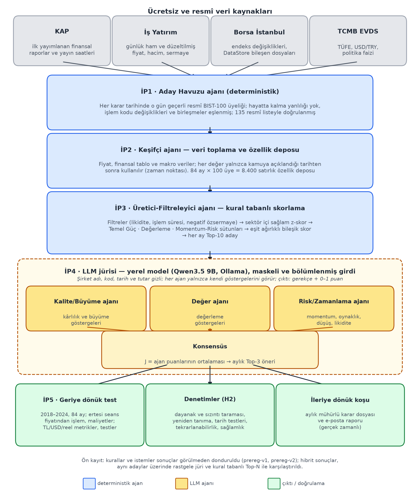
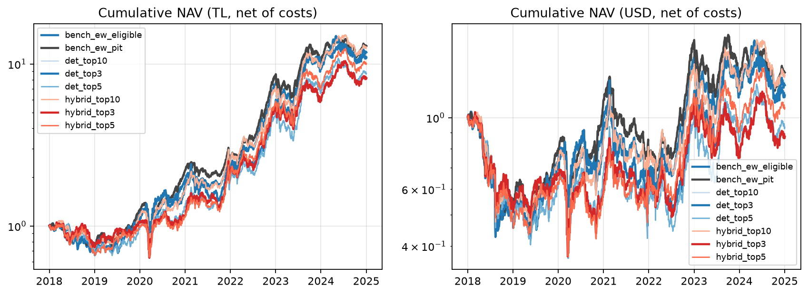
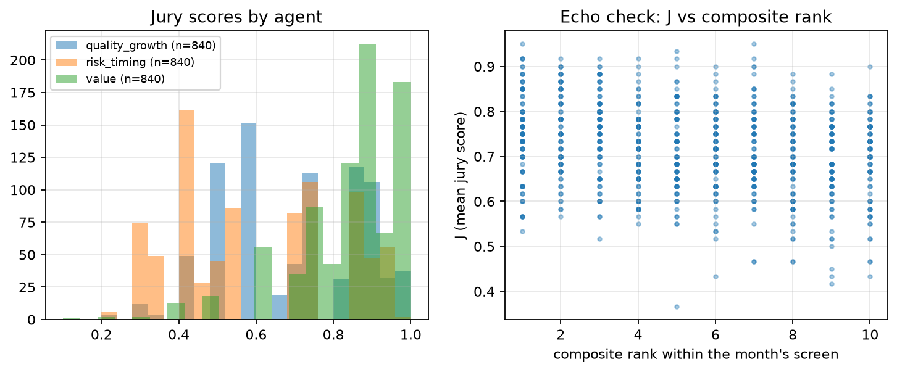

<!-- TÜBİTAK 2209-A Sonuç Raporu (Türkçe teslim metni; depo dili İngilizce, bu dosya istisnadır).
     Resmî .docx şablonuna docs/report/build_docx.py ile aktarılır, PDF docs/report/make_pdf.sh ile üretilir.
     Bölüm 4'teki "önceden kaydedilmemiş" ek analizler: scripts/report_extra_analyses.py
     (data/runs/hybrid-v2/extra_analyses.json). -->

# 2209/A ÜNİVERSİTE ÖĞRENCİLERİ ARAŞTIRMA PROJELERİ DESTEK PROGRAMI — SONUÇ RAPORU

**PROJE BAŞLIĞI:** **KURAL VE LLM TABANLI HİBRİT ÇOKLU AJAN SİSTEMİ İLE HİSSE ÖNERİ SİSTEMİ**

| | |
|---|---|
| Proje yürütücüsünün adı | Vedat Ali Tatlı (Erciyes Üniversitesi, Bilgisayar Mühendisliği) |
| Danışmanın adı | Arş. Gör. Hayri Öztürk |
| Projenin konusu | Borsa İstanbul (BIST-100) hisseleri için kural tabanlı (deterministik) analiz ile yerel büyük dil modeli (LLM) jürisini birleştiren, geriye dönük ve ileriye dönük olarak test edilen hibrit çoklu ajan hisse öneri sistemi |
| Başvuru numarası | 1919B012550729 |
| Proje başlangıç ve bitiş tarihleri | 01.12.2025 – 30.10.2026 |
| Proje ekibi | Vedat Ali Tatlı, Gizem Coşkun, Rabia Yeşil |

## 1. Giriş

Finansal piyasalar, yüksek hacimli ve çok çeşitli verilerle beslenen dinamik, belirsiz ve karmaşık sistemlerdir.
Bu ortamda hisse senedi seçmek ve rasyonel yatırım kararları almak, finansal göstergelerin sayısal analizinin
ötesinde verilerin çok yönlü yorumlanmasını da gerektirdiği için maliyetli ve zaman alıcı bir süreçtir. Bu bölümde
önce projenin ele aldığı problem tanımlanmakta (1.1), ardından projede bu problemin hangi parçalarının nasıl
çözüldüğü (1.2), ilgili çalışmalar ve projenin bu çalışmalardan farkı (1.3) ve test edilen hipotezler (1.4)
açıklanmaktadır.

### 1.1 Problem tanımı

Projenin ele aldığı karar problemi şudur: Borsa İstanbul'un en büyük 100 şirketinden oluşan BIST-100 evreninde,
her ayın son işlem gününde yalnızca o güne kadar kamuya açıklanmış bilgiler kullanılarak, sonraki ay elde
tutulacak az sayıda (üç) hisse seçilmesi ve her seçimin gerekçesinin açık biçimde sunulması. Bu problem üç
alt sorundan oluşmaktadır.

**(a) Yöntem sorunu: kesinlik ile yorum arasındaki boşluk.** Kârlılık, değerleme ve momentum gibi göstergelere
dayanan kural tabanlı tarama sistemleri hızlı, ucuz ve tekrarlanabilirdir; ancak yalnızca sayısal eşikler ve
ağırlıklarla çalıştıkları için göstergeler arasındaki çelişkileri yorumlayamaz ve kararlarını gerekçelendiremezler.
Büyük dil modelleri (LLM) ise göstergeleri yorumlayıp okunabilir gerekçeler üretebilir; fakat sayısal hesaplamada,
yüzlerce şirketin taranmasında ve aynı girdiye aynı cevabı vermede güvenilir değildir. Tüm kararın tek bir LLM'e
ya da tek bir merkezi LLM yöneticisine bırakılması, sistemi o modelin yanlılıklarına ve tek hata noktasına açık
hâle getirmektedir.

**(b) Değerlendirme sorunu: LLM'li geriye dönük testlerin güvenilirliği.** LLM'ler eğitim verilerindeki geçmiş
fiyat ve ekonomik değerleri ezberleyebilmektedir. Model, test edilen dönemin sonuçlarını eğitim sırasında görmüşse
geriye dönük test başarısı gerçek bir öngörü yeteneğinden ayırt edilemez ve modele "geleceği bilmiyormuş gibi
davran" demek de bu etkiyi ortadan kaldırmaz (Lopez-Lira vd., 2025). Şirket adlarının bilinmesi, sızıntı olmasa
bile modelin genel şirket bilgisine dayanarak karar vermesine yol açabilmektedir (Glasserman ve Lin, 2023). LLM
tabanlı alım-satım çalışmaları çoğunlukla adı açıkça verilen az sayıda ABD hissesi ve kısa test dönemleri üzerinde
yürütülmektedir (ör. Yu vd., 2024a, 2024b; Xiao vd., 2024). Bu koşullarda bir LLM katmanının gerçekten
katkı sağlayıp sağlamadığı sorusu, eşit ağırlıklı portföy gibi güçlü bir ölçüte (DeMiguel vd., 2009), işlem
maliyetlerine ve şansa karşı sınanmadan yanıtlanamamaktadır.

**(c) Veri sorunu: Borsa İstanbul'a özgü güçlükler.** BIST-100 bileşimi her çeyrek değişmekte, şirketler endeksten
çıkmakta, birleşmekte veya işlem kodlarını değiştirmektedir (ör. KOZAL→TRALT). Yalnızca bugün işlem gören şirketlerle
yapılan bir test, hayatta kalma yanlılığı nedeniyle sonuçları olduğundan iyi gösterir. Finansal tablolar dönem
sonundan bir ila üç ay sonra açıklanmakta ve sonradan yeniden düzenlenebilmektedir. Bir karar tarihinde henüz
açıklanmamış bir rakamın kullanılması, geleceği görme yanlılığı yaratır. 2023'ten itibaren uygulanan TMS-29
enflasyon muhasebesi, farklı yıllara ait tutarların doğrudan karşılaştırılmasını bozmaktadır. Yüksek enflasyon
nedeniyle nominal Türk lirası getirileri de tek başına anlamlı değildir. Bu sorunları gideren, ücretsiz ve zaman
noktası doğru (point-in-time) bir BIST veri seti hazır olarak bulunmamaktadır.

Buna göre projenin araştırma sorusu şöyle tanımlanmıştır: *Kural tabanlı bir ön elemenin üzerine eklenen ve farklı
yatırım bakış açılarını temsil eden bir LLM jürisi, sızıntıya karşı denetlenen, işlem maliyetlerini içeren ve
önceden kaydedilmiş (pre-registered) bir test düzeninde, yalnızca kural tabanlı sisteme göre riske göre
düzeltilmiş getiriyi ve kararların açıklanabilirliğini artırır mı?*

### 1.2 Projede çözülen sorunlar

Yukarıdaki üç alt soruna karşılık proje kapsamında şu çözümler geliştirilmiştir:

* **Veri sorunu için (İP1–İP2):** Borsa İstanbul'un resmî endeks listeleri ve duyurularından gün bazında yeniden
  kurulan, hayatta kalma yanlılığından arındırılmış bir BIST-100 evreni; KAP'ta ilk açıklanan (sonradan
  düzeltilmemiş) finansal tablolardan ve açıklanma saatlerinden kurulan, her değeri yalnızca açıklandığı andan
  sonra kullanan bir özellik deposu. TMS-29 dönemi için aynı rapordaki karşılaştırmalı rakamlarla hesaplama
  yapılmış, sonuçlar TL'nin yanında ABD doları ve enflasyondan arındırılmış (reel) olarak da raporlanmıştır.
* **Yöntem sorunu için (İP3–İP4):** Görevlerin iki katmana ayrılması. Taramayı, filtrelemeyi ve skorlamayı
  deterministik ajanlar yapar ve her ay tekrarlanabilir bir 10 adaylık liste üretir. LLM yalnızca bu 10 aday
  üzerinde, her biri farklı bir gösterge grubunu gören üç bağımsız jüri ajanı olarak paralel puan ve gerekçe
  üretir. Nihai karar, merkezi bir yöneticinin değil puanların ortalamasının sonucudur.
* **Değerlendirme sorunu için (İP4–İP5):** Jüriye şirket adı, işlem kodu, tarih ve mutlak tutar verilmemesi
  (maskeleme); modelin şirketi veya dönemi tanıyıp tanımadığını ölçen ezber ve sızıntı denetimleri; kuralların ve
  istemlerin sonuçlar görülmeden dondurulması (ön kayıt); hibrit sistemin aynı sayıda hisseli kural tabanlı
  portföy, eşit ağırlıklı BIST-100 ve 500 rastgele jüri ile aynı tarih, aynı işlem fiyatı ve aynı maliyetlerle
  karşılaştırılması.
* **Uygulanabilirlik için:** Gerçek zamanlı aylık karar raporu ve e-posta prototipi; ücretli API kullanmadan
  yerel bir açık modelle (Qwen Team, 2026) çalışan ve açık kaynak olarak yayımlanan bir yazılım.

### 1.3 İlgili çalışmalar ve projenin farkı

Literatürdeki çalışmalar incelendiğinde, finans alanındaki çoklu ajan sistemlerinin çeşitli alt problemlere
odaklandığı görülmektedir. Ancak bu çalışmalar, kural tabanlı kesinlik ile çok bakış açılı dil modeli
muhakemesini birleştiren hibrit bir karar komitesi sunmamaktadır. Türkiye'deki FinTek literatürünü inceleyen
Yıldız (2022), araştırmaların büyük çoğunluğunun yapay sinir ağları ve derin öğrenme teknikleriyle yalnızca fiyat
tahminine odaklandığını belirtmektedir. Geleneksel ajan tabanlı modellerde Raudys ve Zliobaite (2006) durağan
olmayan zaman serisi tahmininde tek katmanlı perseptron ajanların rekabeti ve çoğunluk oylaması üzerinde durmuştur.
Demirtaş ve Çakmak Şahin (2023) ise ajanların genetik algoritmalar veya makine öğrenmesi ile strateji geliştirdiği
evrimsel piyasa simülasyonlarını incelemiştir. İş akışı ve görev dağılımı odaklı çalışmalarda Pandey vd. (2000)
veri toplama, analiz ve emir iletme süreçlerini tek bir finansal danışman ajana devretmiştir. Dodnikov (2024)
ajanların görevleri birbirine aktardığı doğrusal iş akışlarını incelerken, Choi vd. (2025) yapılandırılmamış
finansal belgelerden temel performans göstergelerini çıkarıp veri tabanında sorgulayan ardışık bir mimari
geliştirmiştir.

Son dönemde geliştirilen büyük dil modeli tabanlı çoklu ajan sistemlerinde de benzer yapısal sınırlar
bulunmaktadır. TradingGPT, farklı risk karakterlerine sahip ajanların münazarasına dayanır (Li vd., 2023). Ancak bu
sistem hem ön analiz hem de nihai karar süreçlerinde dil modellerini merkezine aldığı için filtreleme aşamasındaki
belirsizlik riskini artırmaktadır. FinMem, katmanlı belleğe ve ayarlanabilir risk karakterine sahip tek bir LLM
alım-satım ajanıdır (Yu vd., 2024b). Yatırım firmalarını taklit eden FinCon sisteminde (Yu vd., 2024a) tüm ajanların
dil modeli tabanlı olması deterministik filtrelemeyi zorlaştırmakta; analist ajanlardan gelen girdilerin tek bir
merkezi yönetici ajan üzerinde birleştirilmesi sistemi yanlılığa ve tek hata noktası riskine açık hâle
getirmektedir. TradingAgents de temel, duyarlılık ve teknik analist ajanlarının yanında boğa ve ayı
araştırmacılarının münazarası, bir risk ekibi ve nihai kararı veren bir işlemci ajanla bir yatırım şirketini
canlandırmaktadır (Xiao vd., 2024). Finans alanı dışında olmakla birlikte yargısal karar süreçlerini simüle etmesi
bakımından yapısal bir analoji sunan AUTOLAW (Nguyen vd., 2025), LLM jüri üyelerinin çoğunluk oyuyla karar verir;
ancak tamamen metin tabanlı müzakereye dayanır ve matematiksel kuralları kesin olarak uygulayan araç-ajanlar ile
paralel oylama yapan bir karar komitesini bir araya getirmez. Bu LLM sistemlerinin değerlendirmelerinde şirket
adları açık olarak verilmekte ve test dönemleri modellerin eğitim verisi dönemine düşmektedir; bu durum (b)'de
açıklanan ezber sorununu doğurmaktadır (Lopez-Lira vd., 2025). Projenin deterministik katmanı ise değer, kârlılık
ve momentum etkilerini belgeleyen klasik faktör literatürüne dayanmaktadır (Fama ve French, 1993; Jegadeesh ve
Titman, 1993; Asness vd., 2013).

Tablo 1, LLM tabanlı yakın çalışmaları bu projenin tasarım tercihleriyle karşılaştırmaktadır.

| Çalışma | Kararı veren yapı | Deterministik ön eleme katmanı | Bağımsız paralel oylama | Kimlik ve tarih maskeleme |
|---|---|---|---|---|
| TradingGPT (Li vd., 2023) | Farklı karakterli LLM ajanlarının münazarası | Yok | Yok (münazara) | Bildirilmemiş |
| FinMem (Yu vd., 2024b) | Tek LLM ajanı | Yok | Yok | Bildirilmemiş |
| FinCon (Yu vd., 2024a) | Analist ajanlar → merkezi yönetici ajan | Yok | Yok (hiyerarşik) | Bildirilmemiş |
| TradingAgents (Xiao vd., 2024) | Analistler, münazara, risk ekibi → işlemci ajan | Yok | Yok (münazara) | Bildirilmemiş |
| AUTOLAW (Nguyen vd., 2025) | LLM jüri üyelerinin çoğunluk oyu (hukuk alanı) | Yok | Var | Uygulanamaz |
| Bu proje | Deterministik Top-10 → üç LLM jüri ajanının puan ortalaması | Var (kural tabanlı tarama ve skorlama) | Var (bilgi bölümlemeli) | Var (ad, kod, tarih, tutar gizli; denetlenmiş) |

Bu karşılaştırmaya göre projenin özgün yönleri şunlardır:

* **İki katmanlı görev ayrımı:** Hesaplama, filtreleme ve sıralama tamamen deterministik ajanlara bırakılmış;
  LLM yalnızca yorum ve gerekçe gerektiren son seçim adımında kullanılmıştır. Böylece LLM'in zayıf olduğu sayısal
  işlemler sistemden çıkarılmış, her ay aynı girdilerle aynı aday listesi üretilmiştir.
* **Merkezi yönetici yerine bilgi bölümlemeli jüri:** Kalite/büyüme, değer ve risk/zamanlama ajanları birbirinin
  çıktısını görmeden ve her biri yalnızca kendi gösterge grubunu görerek paralel puanlama yapar; karar bu
  puanların ortalamasıdır. Bu yapı tek bir ajanın yanlılığının karara doğrudan geçmesini engeller ve ajanlar arası
  uyumun ölçülebilmesini sağlar.
* **Ezber ve sızıntıya karşı ölçülmüş koruma:** Jüri girdilerinde şirket adı, kod, tarih ve mutlak tutar
  bulunmamaktadır. Modelin maskeli girdilerden şirketi veya dönemi tanıyıp tanıyamadığı ayrıca test edilmiş ve
  sonuçları raporlanmıştır (4.3).
* **Borsa İstanbul'a özgü zaman noktası doğru veri:** Hayatta kalma yanlılığından arındırılmış endeks üyeliği,
  ilk açıklanan finansal tablolar, TMS-29 ve yüksek enflasyon dikkate alınarak TL, ABD doları ve reel bazda
  değerlendirme.
* **Önceden kaydedilmiş ve şansa karşı sınanmış değerlendirme:** Kurallar ve istemler sonuçlar görülmeden git
  etiketleriyle dondurulmuştur. Hibrit sistem aynı adaylardan seçim yapan 500 rastgele jüriyle ve aynı sayıda
  hisseli kural tabanlı portföyle karşılaştırılmıştır. Böylece olumlu ya da olumsuz sonucun şans eseri olup
  olmadığı ayırt edilebilmektedir.
* **Sıfır maliyetli ve tekrarlanabilir kurulum:** Tüm veriler ücretsiz ve resmî kaynaklardan alınmıştır. Jüri,
  sürümü sabitlenmiş yerel bir açık modelle (Ollama, 2026) çalıştırılmış ve her çağrı önbelleğe alınmıştır. Kod
  açık kaynak olarak yayımlanmıştır.

Böylece deterministik ajanların matematiksel kesinliği ile dil modeli jürisinin açıklanabilir nitel muhakemesi tek
bir yapıda birleştirilmiş, tekil bakış açısı riskinin azaltılması amaçlanmıştır.

### 1.4 Hipotezler

Proje kapsamında temel araştırma sorusuna yanıt aramak üzere aşağıdaki iki hipotez test edilmiştir:

* **H1:** LLM jürisi eklenmiş hibrit sistem; aynı dönem, işlem maliyeti ve karşılaştırma ölçütü koşullarında
  yalnızca kural tabanlı sisteme göre daha yüksek riske göre düzeltilmiş getiri sağlar.
* **H2:** Jüri katmanı; gerekçelerin girdiye dayanması, sonuçların tekrar edilebilirliği ile girdi gürültüsüne ve
  istem değişikliğine karşı dayanıklılık göstermesi sayesinde kararların açıklanabilirliğini ve tutarlılığını
  artırır.

Türkiye'deki yüksek enflasyon sebebiyle sadece TL bazlı getirilere odaklanmak gerçek performansı gizleyebilmektedir.
Bu nedenle analiz sonuçları TL'nin yanı sıra ABD doları bazında, TÜFE'ye göre enflasyondan arındırılmış olarak ve
karşılaştırma ölçütüne kıyasla sağlanan aktif getiri üzerinden değerlendirilmiştir.

## 2. Proje Konusu Hakkında Kısa Bilgi

Sistem altı ajandan ve bir doğrulama katmanından oluşur; bunlar öneride tanımlanan beş iş paketine (İP) karşılık
gelir:

| Ajan | Tür | Görev |
|---|---|---|
| Aday Havuzu Ajanı (İP1) | Deterministik | Her karar tarihinde o gün geçerli olan resmî BIST-100 şirketlerini belirler; endeksten çıkan ve işlem kodu değişen şirketleri de kapsayarak hayatta kalma yanlılığını önler. |
| Keşifçi Ajan (İP2) | Deterministik | Fiyat, finansal tablo ve makroekonomik verileri toplar; geleceği görme yanlılığını önlemek için her veriyi yalnızca kamuya açıklandığı tarihten itibaren kullanan özellik deposunu oluşturur. |
| Üretici-Filtreleyici Ajan (İP3) | Deterministik | Likidite, işlem süresi ve özsermaye filtrelerini uygular; Temel Güç, Değerleme ve Momentum-Risk bileşik skorlarını sektör içi sağlam z-skorlarla hesaplayarak her ay ilk 10 adayı seçer. |
| Kalite/Büyüme Jürisi (İP4) | LLM | Aday şirketleri kârlılık, sermaye verimliliği ve büyüme göstergeleri açısından değerlendirerek 0 ile 1 arasında gerekçeli olarak puanlar. |
| Değer Jürisi (İP4) | LLM | Aday şirketleri kazanç getirisi, çarpanlar ve güvenlik marjı gibi değerleme göstergeleri açısından inceleyerek 0 ile 1 arasında gerekçeli olarak puanlar. |
| Risk/Zamanlama Jürisi (İP4) | LLM | Aday şirketleri fiyat momentumu, oynaklık, maksimum düşüş ve likidite göstergeleri açısından değerlendirerek 0 ile 1 arasında gerekçeli olarak puanlar. |
| Geriye Dönük Test ve Doğrulama (İP5) | Çıktı / Doğrulama | Konsensüsle seçilen portföyleri 2018–2024 döneminde işlem maliyetleriyle test eder; TL, USD ve reel performans metrikleri ile istatistiksel doğrulamaları hesaplar. |

Jüri skoru J, geçerli ajan puanlarının ortalaması alınarak elde edilmektedir. Aylık Top-3 öneri J sırasına göre
seçilirken puan eşitliği durumunda bileşik skor sıralaması dikkate alınmakta, J ≥ 0,75 eşiği ise ikincil analizde
"AL" sinyali olarak kullanılmaktadır. Sistem, beşinci iş paketinde 2018–2024 yıllarını kapsayan 84 aylık dönem
boyunca aylık yeniden dengelemeli ve adım adım ileri taşınan (walk-forward) bir geriye dönük testle doğrulanmıştır.
Bunun yanı sıra gerçek zamanlı verilerle ileriye dönük, kâğıt üzerinde işlem yapılan bir test akışı ve e-posta
raporu prototipi geliştirilmiştir. Ajanlar arasındaki veri akışı ve doğrulama adımları Şekil 1'de özetlenmiştir.

Projenin tüm yazılım altyapısı Python 3.12 ile geliştirilmiştir. Ek bir API maliyeti oluşturmayan ve tamamen
tekrar edilebilir bir çalışma ortamı kurmak amacıyla LLM jürisi, sabitlenmiş model sürümüyle Ollama üzerinde yerel
olarak çalıştırılmış; ihtiyaç duyulan tüm veriler ise ücretsiz ve resmî kaynaklardan temin edilmiştir. Geliştirilen
kaynak kodlar, doğrulama testleri ve proje belgeleri açık kaynak olarak paylaşılmıştır:
https://github.com/vedattatli/bistmas-2209a

## 3. Rapor Dönemlerinde Yapılan Çalışmalar

### 3.1 İP1 — Dinamik BIST-100 Evreni (Aday Havuzu Ajanı)
* Borsa İstanbul'un dönemsel endeks değişikliği duyuruları, resmî ağırlık dosyaları ve Borsa İstanbul DataStore
  (Borsa İstanbul, 2026) üzerinde ücretsiz sunulan "2000 yılından itibaren endekslerde bulunan şirketler" kayıtları
  birleştirilerek, 2017–2026 dönemi için BIST-100, BIST-50 ve BIST-30 endeks üyelikleri gün bazında yeniden
  oluşturulmuştur. Bu kapsamda Temmuz 2017 ile Ekim 2026 arasında BIST-100 endeksine girip çıkan toplam 255 farklı
  işlem kodu tarihsel olarak modellenmiştir.
* Endeks dönemleri içinde gerçekleşen hızlı giriş, şirket birleşmesi ve kottan çıkma gibi ara olaylar, KAP
  bildirimleri üzerinden tek tek tarihlendirilmiştir. Oluşturulan dinamik evren, Temmuz 2017 ile Temmuz 2026
  arasındaki dönemi kapsayan 135 resmî Borsa İstanbul DataStore endeks listesinin tamamıyla birebir örtüşerek
  doğrulanmıştır.
* Süreç içerisinde işlem kodu değişen şirketler (örneğin KOZAL→TRALT, KOZAA→TRMET, IPEKE→TRENJ, KERVT→BESLR,
  EFORC→EFOR) eski ve yeni kodlarıyla eşleştirilmiştir. Böylece zaman içinde endeksten çıkan veya unvanı değişen
  hisselerin veri setinden düşmesi engellenerek hayatta kalma yanlılığı giderilmiştir.

### 3.2 İP2 — Veri Toplama ve Özellik Deposu (Keşifçi Ajanı)
* **Fiyatlar:** İş Yatırım'dan (İş Yatırım, 2026) alınan ham ve düzeltilmiş günlük fiyat serileri kullanılarak,
  2 Ocak 2017 ile 23 Eylül 2026 tarihleri arasındaki 2.436 seansı ve 249 hisseyi kapsayan 490.690 satırlık bir veri
  seti oluşturulmuştur. Sermaye artırımı, bedelsiz bölünme ve temettü dağıtımı gibi 661 kurumsal olay tek tek
  tespit edilip denetlenmiş, veri sağlayıcı kaynaklı fiyat düzeltme hataları oluşturulan bir düzeltme tablosuyla
  giderilmiştir. İşlem görmeyen seanslar ise veri bütünlüğünü bozmayacak şekilde ayrıca ele alınmıştır.
* **Finansal tablolar:** KAP'ta (KAP, 2026) yayımlanan ve sonradan revize edilmemiş ilk finansal raporlar şirket
  bazında indirilerek ayrıştırılmış; toplamda 243 şirkete ait 6.521 rapor ve 3,26 milyon tablo satırı işlenmiştir.
  Sanayi, katılım bankaları dâhil bankacılık, sigorta ve diğer mali kuruluş şablonları kendi yapılarına uygun ayrı
  kavram eşlemeleriyle standartlaştırılmıştır. KAP arşivinde eski raporları bulunmayan ve endeksten erken ayrılmış
  birkaç şirket için İş Yatırım'ın ilk açıklanan tarihsel verileri yedek kaynak olarak kullanılmıştır. Son on iki
  aylık (TTM) değerler aynı rapordaki karşılaştırmalı rakamlardan hesaplanmış, TMS-29 enflasyon muhasebesine geçiş
  sürecinde farklı muhasebe tabanlarının birbirine karıştırılmamasına özen gösterilmiştir.
* **Makroekonomik veriler:** TCMB Elektronik Veri Dağıtım Sistemi (TCMB, 2026) üzerinden 2003=100 ve 2025=100
  bazlı TÜFE serileri birleştirilerek çekilmiş ve her ayın enflasyon verisi yalnızca resmî olarak açıklandığı
  günden itibaren sisteme dâhil edilmiştir. Benzer şekilde USD/TRY kuru (EVDS öncelikli olmak üzere eksik günlerde
  veri sağlayıcı serisiyle tamamlanarak) ve TCMB politika faizi de yürürlük tarihleri esas alınarak veri setine
  eklenmiştir.
* **Özellik deposu:** 84 karar tarihi ve her tarihteki 100 endeks üyesi üzerinden toplam 8.400 satırlık bir özellik
  deposu üretilmiştir. Her satırda, kullanılan son finansal tablonun dönem sonu ve kamuya açıklanma tarihi ile
  fiyat tarihi kayıt altına alınmıştır. Karar tarihinden sonra açıklanan hiçbir bilginin analizde kullanılmadığı
  (geleceği görme yanlılığının olmadığı) her satır için otomatik testlerle doğrulanmıştır. Oluşturulan özellik
  deposundaki satırların %84,6'sı başlangıç filtrelerinden geçmektedir.

### 3.3 İP3 — Deterministik Filtreleme ve Skorlama (Üretici-Filtreleyici Ajanı)
* **Filtreler:** Adayların en az 250 seans işlem görmüş olması ve son altı aylık ortalama günlük işlem hacminin
  hem 5 milyon TL'nin hem de o ayki endeks üyelerinin yüzde onluk diliminin üzerinde olması şart koşulmuştur.
  Ayrıca şirketlerin güncel fiyat verisi ile en fazla 400 günlük bir finansal tabloya sahip olması gerekmekte olup
  negatif özsermayeli şirketler değerlendirme dışı bırakılmıştır.
* **Göstergeler:** Şirketler sanayi şablonuna göre temel güç, değerleme ve momentum ile risk olmak üzere üç ana
  başlıkta incelenmiştir. Temel güç için yatırılan sermayenin getirisi, brüt ve faaliyet marjı ile gelir ve kâr
  büyümesi dikkate alınmıştır. Değerleme aşamasında kazanç getirisi, defter/piyasa değeri, FAVÖK getirisi ve
  serbest nakit akışı getirisi kullanılmıştır. Momentum ve risk ölçümü için ise son bir yıllık momentum, altı
  aylık oynaklık, en büyük düşüş ve ortalama işlem hacmi baz alınmıştır. Bu gösterge seçimi değer, kârlılık ve
  momentum etkilerine ilişkin faktör literatürüne dayanmaktadır (Fama ve French, 1993; Jegadeesh ve Titman, 1993;
  Asness vd., 2013). Bankalar, sigorta şirketleri ve diğer mali kuruluşlar için bu göstergeler özsermaye kârlılığı,
  net faiz marjı, maliyet/gelir oranı ve aktif kârlılığı gibi sektöre özgü metriklerle uyarlanmıştır.
* **Normalleştirme:** Elde edilen tüm veriler her ay sektör grupları içinde medyan değerleri kullanılarak sağlam
  z-skor yöntemiyle normalleştirilmiş ve uç değerler kırpılmıştır. Gözlem sayısı az olan alt gruplar mali veya mali
  olmayan şirketler olarak daha üst bir kategoride birleştirilmiştir. Son aşamada bu üç ana sütun eşit
  ağırlıklandırılarak nihai bir bileşik skor elde edilmiş ve her ay en yüksek puanı alan on aday jüri
  değerlendirmesine aktarılmıştır.

### 3.4 İP4 — LLM Jüri Ajanları ve Konsensüs
* **Model:** Qwen3.5 9B modeli (Qwen Team, 2026) yerel Ollama sunucusunda (Ollama, 2026) sabitlenmiş model
  özetiyle çalıştırılmıştır. Sistemde sıcaklık değeri sıfır, tohum değeri sabit tutulmuş ve modelin düşünme kipi
  kapalı konuma getirilmiştir. Herhangi bir ücretli API kullanılmamış olup, her çağrı önbelleğe alınarak koşuların
  tekrarlanabilir ve istenildiğinde kaldığı yerden sürdürülebilir olması sağlanmıştır.
* **Bilgi bölümlemesi:** Her jüri ajanı yalnızca kendi uzmanlık alanına ait göstergeleri, yani z-skorlarını ve
  akran grubu içindeki yüzdelik dilimleri değerlendirir. Modelin geçmiş piyasa bilgilerini ezberleyip sızdırmasını
  önlemek amacıyla değerlendirme istemlerinde şirket adı, işlem kodu, tarih ve mutlak tutarlara yer verilmemiştir.
  Bunun yerine şirketler her ay güncellenen takma adlarla sisteme sunulmuş ve bu güvenlik kurallarının ihlal
  edilmediği her istem için otomatik olarak doğrulanmıştır.
* **Çıktı şeması:** Jüri ajanlarının değerlendirmelerini sunarken önce kararın gerekçesini, ardından sıfır ile bir
  arasında değişen puanını iletmesi sağlanmıştır. Gerekçe metninde yalnızca modele verilen istemdeki alanlara atıf
  yapılmasına izin verilmiştir. Çıktı şemasına uymayan bir yanıt alındığında sistem aynı istemi bir kez daha
  gönderir; modelin tekrar uyumsuz bir yanıt üretmesi durumunda ise ilgili ajan çekimser kabul edilir. Ayrıca
  sistemin nihai bir konsensüse varabilmesi için en az iki ajanın geçerli oy kullanması şart koşulmuştur.
* **Toplam değerlendirme süreci:** 84 aylık test dönemi boyunca her ay on aday hisse üç farklı ajan tarafından
  değerlendirilmiş ve bu süreçte toplam 2.520 model çağrısı gerçekleştirilmiştir. Her bir model çağrısının
  yanıtlanması ortalama 23 saniye sürmüştür.

### 3.5 İP5 — Geriye Dönük Test ve Doğrulama
* **Test motoru:** Sistemde kararlar her ayın son seansında verilmiş ve alım satım işlemleri bir sonraki seansın
  ağırlıklı ortalama fiyatı üzerinden gerçekleştirilmiştir. Gerçekçi bir senaryo oluşturmak amacıyla işlemlere
  binde bir oranında komisyon ile 20 baz puanlık kayma maliyeti eklenmiş, işlem görmeyen hisseler için ise
  portföyde nakit tutulması sağlanmıştır.
* **Karşılaştırma ölçütü:** Sistemin performansı öncelikli olarak o tarihteki tüm BIST-100 üyelerinden oluşan eşit
  ağırlıklı bir portföy ile aynı tarih ve maliyet koşullarında karşılaştırılmıştır. Eşit ağırlıklı portföy,
  literatürde aşılması güç bir ölçüt olarak bilinmektedir (DeMiguel vd., 2009). İkincil karşılaştırma ölçütü olarak
  ise yalnızca filtreleme aşamasını geçen hisselerin eşit ağırlıklı portföyü ile BIST-100 fiyat endeksi
  kullanılmıştır.
* **Performans ölçütleri:** Değerlendirme sürecinde yıllık bileşik getiri, en büyük düşüş ile TCMB politika faizi
  baz alınarak hesaplanan Sharpe ve Sortino oranları dikkate alınmıştır. Aylık aktif getirinin istatistiksel
  anlamlılığı Newey-West t-testi (Newey ve West, 1987) ve durağan blok bootstrap güven aralığı (Politis ve Romano,
  1994) ile incelenmiş, ayrıca deneme sayısına göre düzeltilmiş Sharpe oranı (Bailey ve López de Prado, 2014)
  hesaplanmıştır. Sistemin güvenilirliğini sınamak için 500 tohumlu rastgele jüri dağılımı oluşturulmuş, maliyet ve
  kottan çıkış durumlarına yönelik duyarlılık analizleri yapılmıştır.
* **Ön kayıt süreci:** Değerlendirmelerden önce tüm parametreler, hipotez testleri ve veri sürümleri dondurularak
  ilk sürüm etiketiyle (prereg-v1) kayıt altına alınmıştır. Jüri değerlendirmesi devam ederken ve sonuçlar henüz
  hesaplanmamışken sistem bağımsız bir doğruluk incelemesinden geçirilmiş, elde edilen her bulgu iki ayrı
  doğrulayıcı tarafından test edilmiştir. Tespit edilen veri ve hesaplama hataları giderildikten sonra düzeltilmiş
  şartname ikinci bir sürüm (prereg-v2) olarak yeniden dondurulmuştur. Raporda birincil sonuçlar bu güncel sürüme
  dayandırılırken, ilk kayıt sürümü ikincil analiz olarak sunulmuştur.

### 3.6 İleriye Dönük Koşu ve E-posta Raporu Prototipi
Sisteme, her ayın son seansının ardından güncel verilerle en iyi üç hisse kararını üreten, bu kararı zaman damgası
ve özet sertifikasıyla mühürleyip e-posta formatında ileten bir modül eklenmiştir. Karar tarihleri belirlenirken
yalnızca tamamlanmış aylar ve resmî tatiller dikkate alınmıştır. Planlanan uygulama seansı ayın ilk seansından
sonraya kalırsa, bu kararlar sistem tarafından "geç" üretilmiş olarak etiketlenmektedir.

Sistemin çalışmasına örnek olarak 30 Eylül 2026 verileriyle üretilip 21 Ekim 2026 seansında uygulanmak üzere
mühürlenen geç etiketli bir karar incelenebilir. Bu örnekte jüri, kural tabanlı on aday içinden sırasıyla TUPRS
(J = 0,883), KTLEV (0,867) ve THYAO (0,850) hisselerini seçmiş ve üç ajanın tamamı geçerli oy kullanmıştır.
Üretilen raporda seçilen her hisse için üç ajanın sunduğu ayrıntılı gerekçelere yer verilmektedir. Örneğin değer
ajanı THYAO hissesine, kazanç, defter ve FAVÖK getirilerinin akran grubunda en üst seviyede olduğunu ancak serbest
nakit akışı getirisinin biraz geride kaldığını belirterek 0,95 puan vermiştir. Bu içeriği HTML formatında ileten
e-posta raporunun tam metni Ek-1'de sunulmuştur; sistemin ürettiği bu çıktılar yatırım tavsiyesi niteliği
taşımamaktadır.

### 3.7 Yazılım Altyapısı ve İş Bölümü
Projenin yazılım altyapısı MIT lisansıyla açık kaynak olarak paylaşılan bistmas deposunda toplanmıştır. Bu depo
yaklaşık 15.900 satır Python kodu ve yaklaşık 390 otomatik test içermektedir. Sistemde modüller arası bağımlılık
kuralları tanımlanmış ve her deneyin veri sürümü ile yapılandırma özetinin kaydedildiği bir deney defteri
oluşturulmuştur. Proje sürecindeki iş bölümü kapsamında Vedat Ali Tatlı birinci ve ikinci iş paketlerini kapsayan
veri katmanı ile proje yönetimini üstlenirken, Rabia Yeşil üçüncü ve beşinci iş paketlerindeki skorlama ve geriye
dönük test süreçlerini yürütmüştür. Gizem Coşkun ise dördüncü iş paketi olan jüri ajanları, sistem denetimleri,
ileriye dönük koşu ve raporlama aşamalarında görev almıştır.

### 3.8 Üretken Yapay Zekâ (ÜYZ) Kullanım Beyanı
Proje sürecinde üretken yapay zekâ araçlarından faydalanılmış ve bu kullanım "TÜBİTAK Destek Süreçlerinde Üretken
Yapay Zekânın Sorumlu ve Güvenilir Kullanımı Rehberi"ne uygun olarak beyan edilmiştir. Çalışmalarda kodlama
asistanı olarak Anthropic Claude kullanılmış ve bu araca altıncı bölümde ayrıntıları verilen Claude Max aboneliği
üzerinden erişilmiştir. Yapay zekâ desteği yazılımın kodlanması, testlerin yazılması, veri işleme ve analiz
betiklerinin oluşturulmasının yanı sıra kod incelemesi, proje belgeleri ve sonuç raporunun taslak metinlerinin
hazırlanması aşamalarında kullanılmıştır.

Sistem tasarımı, iş paketleri, veri kaynaklarının seçimi ile yöntem ve parametre kararları proje ekibi tarafından
alınmıştır. Kod ve metin taslakları bu kararlar doğrultusunda yapay zekâ aracıyla üretilmiş, ardından ekip
tarafından incelenip düzenlenmiştir. Yazılan kodların doğruluğu otomatik testler ve veri dosyası karşılaştırmalarıyla
sınanmış, ön kayıt süreci ile bağımsız doğruluk incelemeleri de bu kontrol aşamasına dâhil edilmiştir. Raporda yer
alan tüm sayısal veriler doğrudan sistemin ürettiği sonuç dosyalarından alınmış olup nihai metnin ve sonuçların
tüm sorumluluğu proje ekibine aittir. Sistemin araştırma konusu olan ve yerel olarak çalıştırılan Qwen3.5 9B jüri
modeli (Qwen Team, 2026), yapay zekâ yardımcısı olarak değil projenin doğrudan test edilen bir parçası olarak
kullanıldığından bu beyanın kapsamı dışında tutulmuştur.

TÜBİTAK ÜYZ Rehberi'ndeki veri gizliliği ilkeleri doğrultusunda, kullanılan ticari ÜYZ aracına (Claude) hiçbir
kişisel veri, gizli bilgi veya kamuya açık olmayan ticari sır girilmemiştir; sistemde işlenen tüm finansal veriler
KAP, Borsa İstanbul ve TCMB gibi kamuya açık resmî kaynaklardan alınmıştır. ÜYZ asistanı tarafından üretilen tüm
kod betikleri ve analiz şablonları yaklaşık 390 otomatik birim ve entegrasyon testi, bağımsız doğrulayıcı
incelemeleri ve ham veri dosyalarıyla yapılan çapraz kontrollerden geçirilerek doğrulanmıştır.

### 3.9 Çalışma Takvimi ve Başarı Ölçütlerinin Gerçekleşme Durumu
Öneride her iş paketi için bir dönem ve başarı ölçütü tanımlanmıştı. Aşağıdaki tablo bu ölçütleri ve gerçekleşme
durumunu karşılaştırmaktadır.

| İş paketi ve önerilen dönem | Başarı ölçütü | Gerçekleşme durumu |
|---|---|---|
| İP-1 Aday havuzu ajanı (12/2025) | BIST-100 evreninin kurulması ve eksik veri oranının %2'nin altında olması | Başarıyla gerçekleşti. BIST-100 evreni oluşturuldu ve Borsa İstanbul'un 135 resmî bileşen listesiyle birebir doğrulandı. Her karar tarihinde endeks üyelerinin %99,3–100'ünün işlem fiyatına ulaşıldı. |
| İP-2 Veri toplama ve özellik deposu (01–02/2026) | Veri akışının otomatikleşmesi ve özellik deposundan 300 milisaniyenin altında sorgu yapılması | Kaynak değişikliğiyle gerçekleşti. Finnhub yerine KAP, İş Yatırım, Borsa İstanbul DataStore ve TCMB EVDS gibi ücretsiz kamu kaynakları kullanıldı. Veri akışı kaldığı yerden devam edebilen komut satırı işleri olarak otomatikleştirildi. Özellik deposu sorgusu yaklaşık 2 milisaniyeye düştü ve finansal tablo kapsamı %99,7'ye ulaştı. |
| İP-3 Faktör hesaplama ve normalizasyon (03–04/2026) | Tüm faktörlerin hesaplanması ve faktör korelasyon raporunun oluşturulması | Süreç sadeleştirilerek gerçekleşti. Dört faktör grubu yerine temel güç, değerleme ve momentum-risk sütunları sektör içi sağlam z-skor yöntemiyle hesaplandı. Sütunlar arası Spearman korelasyonu 0,17–0,28 aralığında kaldı; sütunlar birbirinden büyük ölçüde bağımsızdır. |
| İP-3 Filtreleme ve ön eleme (05/2026) | Filtreleme sonrası eksik veri oranının %1'in altında kalması ve en iyi on aday listesinin oluşturulması | Başarıyla gerçekleşti. 84 ayın tamamında en iyi on aday listesi üretildi ve bu adayların hepsinde üç sütun eksiksiz hesaplandı. |
| İP-4 Konsensüs ve raporlama modülü (05–08/2026) | En iyi üç kararın otomatik üretilmesi ve e-posta ile ayrıntılı özet rapor şablonunun oluşturulması | Başarıyla gerçekleşti. Üç jüri ajanıyla konsensüs sağlanarak en iyi üç hisse seçimi yapıldı; aylık karar raporu ve e-posta raporu prototipi geliştirildi (Ek-1). |
| İP-5 Sistem doğrulaması (08–10/2026) | Yıllık bileşik getiri, Sharpe ve Sortino oranları ile en büyük düşüş metriklerinin hesaplanıp kıyaslanması | Başarıyla gerçekleşti. 84 aylık geriye dönük test yapıldı. TL, ABD doları ve reel metrikler hesaplanarak sonuçlar eşit ağırlıklı BIST-100 portföyüyle istatistiksel olarak kıyaslandı (4.1–4.2). |
| Sonuç analizi ve raporlama (11/2026; öngörülenden erken tamamlandı) | Nihai raporun ve açık kaynak deponun tamamlanması, yıllık bileşik getirinin %15'in ve Sharpe oranının 1,2'nin üzerinde olması, 70B modele geçiş | Kısmen gerçekleşti. Rapor ve açık kaynak depo tamamlandı. Getiri hedefi tüm portföylerde aşılsa da bu durumun enflasyondan kaynaklandığı görüldü; politika faizi düşülerek hesaplanan Sharpe hedefine ulaşılamadı. Donanım kısıtları nedeniyle 70B modele geçiş yapılamadı; bunun yerine farklı model aileleriyle çapraz jüri kurulması önerildi (4.4). |

**Takvim notu:** Başvuru önerisinde Kasım 2026 olarak öngörülen sonuç analizi ve raporlama iş paketi, veri akışının
ve yerel jüri değerlendirmelerinin otomatikleştirilmesi sayesinde proje bitiş tarihi olan 30.10.2026 itibarıyla
planlanandan önce tamamlanmıştır.

## 4. Sonuç

### 4.1 Kural Tabanlı Sistem (2018–2024, 84 ay)

| Portföy | CAGR (TL) | Sharpe | CAGR (USD) | CAGR (reel) | Aylık aktif getiri (t) |
|---|---|---|---|---|---|
| Kural tabanlı Top-3 | %40,8 | 0,56 | %2,3 | %4,2 | −%0,05 (−0,07) |
| Kural tabanlı Top-5 | %36,3 | 0,48 | −%1,0 | %0,9 | −%0,37 (−0,60) |
| Kural tabanlı Top-10 | %43,7 | 0,67 | %4,4 | %6,4 | +%0,06 (0,12) |
| BIST-100 eşit ağırlık (ölçüt) | %44,1 | 0,73 | %4,7 | %6,7 | — |
| Filtreden geçenler eşit ağırlık | %42,3 | 0,68 | %3,4 | %5,3 | — |

Kural tabanlı skor tek başına eşit ağırlıklı BIST-100 portföyünü anlamlı bir şekilde geçememiştir. Nominal TL
getirileri önerideki %15'lik bileşik getiri hedefinin çok üzerinde gerçekleşse de bu durum dönemin yüksek
enflasyonunu yansıtmaktadır ve karşılaştırma ölçütü de benzer seviyelerdedir. Reel ve dolar bazındaki getiriler
ise tek haneli rakamlarda kalmıştır. Öneride hedeflenen 1,2'nin üzerindeki Sharpe oranına, risksiz getiri olarak
TCMB politika faizi düşüldüğünde karşılaştırma ölçütü dâhil hiçbir portföy ulaşamamıştır. Bunun temel nedeni,
yüksek faiz döneminde hisse getirilerinin risksiz getiriyi aşan kısmının oldukça sınırlı kalmasıdır.

### 4.2 Hibrit Sistem — H1
Birincil analizde (prereg-v2) jüri, 84 ayın tamamında 2.520 değerlendirmenin hepsini geçerli bir şekilde
tamamlamış ve hiç çekimser kalmadan her aday için jüri skorunu hesaplamıştır.

| Portföy | CAGR (TL) | Sharpe | En büyük düşüş | CAGR (USD) | CAGR (reel) | Aylık aktif getiri (NW t) | Hibrit − kural (NW t, p) |
|---|---|---|---|---|---|---|---|
| Hibrit Top-3 | %35,0 | 0,45 | −%41,5 | −%1,9 | %0,0 | −%0,48 (−0,65) | −%0,43 (−0,56; 0,58) |
| Kural tabanlı Top-3 | %40,8 | 0,56 | −%40,8 | %2,3 | %4,2 | −%0,05 (−0,07) | — |
| Hibrit Top-5 | %39,0 | 0,54 | −%37,8 | %1,0 | %2,9 | −%0,22 (−0,29) | +%0,15 (0,32; 0,75) |
| Kural tabanlı Top-5 | %36,3 | 0,48 | −%41,2 | −%1,0 | %0,9 | −%0,37 (−0,60) | — |
| Hibrit = kural tabanlı Top-10 | %43,7 | 0,67 | −%40,3 | %4,4 | %6,4 | +%0,06 (0,12) | 0 |
| BIST-100 eşit ağırlık (ölçüt) | %44,1 | 0,73 | −%35,5 | %4,7 | %6,7 | — | — |

* **Birinci hipotez (H1) desteklenmemiştir.** H1 doğrudan riske göre düzeltilmiş getiri üstünlüğü iddiası
  taşıdığı için iki soru incelenmiştir: (1) Hibrit sistem daha yüksek ortalama getiri sağlamakta mıdır? (2) Hibrit
  sistem üstlendiği riske kıyasla (Sharpe oranı) daha iyi performans göstermekte midir? İlk soru için uygulanan
  Newey-West t-testi (Newey ve West, 1987; t = −0,56, p = 0,58), iki sistem arasındaki aylık ortalama getiri
  farkının (−%0,43; %95 bootstrap güven aralığı −%1,68 ile +%0,86) istatistiksel olarak anlamlı olmadığını
  göstermektedir. İkinci soru için yıllıklaştırılmış Sharpe oranları incelendiğinde hibrit Top-3 portföyü (0,45),
  kural tabanlı Top-3 portföyünün (0,56) 0,11 puan gerisinde kalmıştır. Günlük fazla getiriler üzerinde eşleştirilmiş
  durağan blok bootstrap (ortalama blok uzunluğu 21 seans, 2.000 tekrar) ile Sharpe farkı (Sharpe_hibrit −
  Sharpe_kural) sınandığında %95 güven aralığı −0,61 ile +0,40 arasında bulunmuş ve sıfırı kapsamıştır; tekrarların
  %32'sinde fark pozitif çıkmıştır. Dolayısıyla bulgular, hem ham getiri farkı hem de risk ayarlı getiri bakımından
  H1'i desteklememektedir. Bununla birlikte, 84 aylık örneklemdeki istatistiksel güç sınırları göz önüne
  alındığında, bu bulgu "LLM jürisinin hiçbir koşulda katkısı olamaz" şeklinde mutlak bir yanlışlama olarak değil,
  incelenen örneklem ve model ölçeğinde anlamlı bir üstünlük gözlenmediği şeklinde yorumlanmalıdır. Top-5
  portföyünde hibrit sistem ayda %0,15 önde olsa da bu fark da anlamlı değildir. Jüriye her ay 10 aday gönderildiği
  için Top-10 portföyü her iki sistemde de aynıdır. Portföylerin işlem maliyetleri düşülmüş net değer eğrileri
  Şekil 2'de sunulmuştur.
* Aynı adaylara rastgele puan veren 500 rastgele jüri simülasyonu ile karşılaştırıldığında, hibrit Top-3
  portföyünün getirisi bu dağılımın 41. yüzdeliğinde kalmıştır. Rastgele jürilerin yıllık bileşik getiri ortalaması
  %36,6 olup %5–%95 aralığı %24,4 ile %49,1 arasındadır. Bu durum, jürinin yaptığı sıralamanın aday listesinin
  rastgele sıralanmasından ayırt edilemediğini göstermektedir.
* Jüri skoru J ile bileşik skor arasındaki aylık Spearman korelasyonu ortalama 0,22'dir. Buna göre jüri skoru
  bileşik skoru doğrudan tekrar etmemekte, ancak bir sonraki ayın getirisi için bileşik sıralamanın ötesinde ek bir
  bilgi de taşımamaktadır (jüri skorunun kesitsel regresyon katsayısı 0,005; t = 0,10).
* Jüri skorunun θ eşiğinden büyük veya eşit olduğu adaylar için alım yapılan, aksi takdirde nakitte kalınan "AL"
  sinyali varyantı da incelenmiştir. θ = 0,75 için ayda ortalama 4,3 AL sinyali üretilmiş, yalnızca 2 ay nakitte
  kalınmış ve TL bazında %39,3 yıllık bileşik getiri sağlanmıştır (aylık aktif −%0,23; t = −0,30). Eşiğin 0,70 veya
  0,80 olarak değiştirilmesi sonucu değiştirmemiştir (aktif t sırasıyla −0,03 ve −1,06).
* İncelenen hiçbir portföyün aktif getirisi, 8 yapılandırma için α = 0,0063 ile yapılan Bonferroni düzeltmesi
  öncesinde veya sonrasında anlamlı çıkmamıştır. Deneme sayısına göre düzeltilmiş Sharpe olasılığı hibrit Top-3
  için 0,02'dir.

### 4.3 Açıklanabilirlik ve Tutarlılık — H2

* **Gerekçelerin girdiye dayanması:** 2.520 gerekçenin %99,7'si yalnızca modele verilen göstergelere atıf yapmış
  olup bu oran ajanlar bazında sırasıyla %100, %99,9 ve %99,3'tür. Üretilen gerekçelerde şirket adı, işlem kodu,
  yıl veya ay adı gibi hiçbir bilgi sızıntısı bulunmamış ve sızıntı bayrağı oranı %0 olmuştur.
* **Tekrarlanabilirlik:** Örneklemdeki 17 aday, sıcaklık değeri 0,7 olarak ayarlanıp beşer kez yeniden
  puanlanmıştır. Sınıf içi korelasyon Kalite/Büyüme ajanında 0,84, Risk/Zamanlama ajanında 0,85, Değer ajanında
  ise 0,55'tir. İlk iki ajanın puanları rastgeleliğe karşı yüksek tutarlılık gösterirken Değer ajanının puanları
  orta düzeyde tutarlıdır.
* **Sağlamlık:** Tabakalı olarak seçilen altı karar ayında jüri iki farklı koşul altında toplam 360 çağrı ile
  yeniden çalıştırılmıştır. İstemdeki tüm z-skorlarına ±0,25 aralığında rastgele gürültü eklendiğinde jüri
  sıralaması ile asıl sıralama arasındaki Kendall tau değeri ortalama 0,63, Top-3 örtüşmesi ortalama %78 olmuştur
  (üç hisseden yaklaşık 2,3'ü aynı kalmıştır). İstemler aynı içerikle yeniden yazıldığında tau 0,57 ve örtüşme
  yine %78'dir. Jüri kararları küçük girdi ve ifade değişikliklerine karşı orta düzeyde sağlamdır. Top-3'ün yaklaşık
  üçte biri sınırdaki adaylar arasında yer değiştirmektedir; bu durum jüri skorunun ek getiri bilgisi
  taşımamasıyla tutarlıdır.
* **Ajanlar arası uyum:** Ajanların aynı aday için verdikleri puanlar arasındaki ortalama ikili Spearman
  korelasyonu −0,10, Krippendorff alfa (Krippendorff, 2004) aralık değeri −0,19'dur. Her ajan farklı bir gösterge
  grubunu incelediği için bu beklenen bir sonuçtur; jüri tek bir görüşün tekrarı değil, üç ayrı bakış açısıdır.
  Şekil 3'te görüldüğü üzere puan dağılımları da farklıdır: Değer ajanı en cömert, Risk/Zamanlama ajanı en
  eleştirel puanlamayı yapmaktadır. Burada raporlanan negatif uyum değerleri, aynı boyutu ölçen değerlendiriciler
  arasındaki klasik bir güvenilirlik ölçütü olarak değil, farklı finansal boyutlara odaklanan ajanların birbirinden
  bağımsız sinyaller ürettiğinin göstergesi olarak okunmalıdır.
* **Puan birleştirme yöntemine duyarlılık (önceden kaydedilmemiş ek analiz):** Ajanların puan ölçeklerinin farklı
  olması, ham puanların doğrudan ortalanmasının nihai skoru etkileyip etkilemediği sorusunu doğurmaktadır. Bu
  nedenle önceden kaydedilen ham ortalamaya ek olarak iki alternatif aynı test motoru ve maliyetlerle denenmiştir.
  Ajan puanları her ay kendi içinde z-skora çevrilip ortalandığında hibrit Top-3'ün yıllık bileşik getirisi %41,2
  (Sharpe 0,58), sıra tabanlı birleştirmede %40,3 (Sharpe 0,56) olmuş; kural tabanlı Top-3'e göre aylık fark
  sırasıyla −%0,06 (t = −0,07) ve −%0,09 (t = −0,11) olarak bulunmuştur. Ölçek farkının giderilmesi hibrit sistemin
  açığını büyük ölçüde kapatmakta, ancak anlamlı bir üstünlük yaratmamaktadır. Bu analizler sonuçlar görüldükten
  sonra yapıldığı için H1 kararını değiştirmemekte, sonraki bir ön kayıtta birincil birleştirme kuralı olarak
  sınanması gereken bir bulgu olarak raporlanmaktadır.
* **Ezber ve sızıntı denetimleri:** 84 adaylık tabakalı bir örneklem üzerinde yapılan denetimlerde, maskelenmiş
  göstergelerden şirketi doğru tahmin etme oranı yaklaşık %1'lik şans düzeyine karşılık %0 olarak bulunmuştur. Yıl
  ve çeyrek tahmini ise %3,4'lük şans düzeyine yakın biçimde %3,6'dır. Bu sonuç, bu örneklemde ve uygulanan
  sorgulama protokolü altında modelin şirket kimliğini veya dönem bilgisini maskeli göstergelerden çıkaramadığına
  işaret etmektedir. Doğrudan şirket adı ve tarih verilerek yapılan fiyat tahminlerindeki yüksek hata (ortalama
  mutlak yüzde hata %90; %10 hata payı içinde doğruluk %4,8; yön doğruluğu %45) modelin ilgili dönem fiyatlarını
  doğrudan hatırlayamadığını göstermektedir. Ancak bu testler modelin örtük tarihsel bilgisinden hiçbir koşulda
  yararlanamayacağını kanıtlamaz; yalnızca belirlenen denetim ölçütleri bakımından açık bir sızıntı gözlenmediğini
  gösterir. Model bu sorularda "bilmiyorum" demek yerine ortalama 0,85 olasılıkla bir yön belirtmiştir; bilmediği
  konularda kendinden emin yanıt verme eğilimi, istemlerde kimlik ve tarihin gizlenmesi kuralının gerekliliğini
  doğrulamaktadır. Ayrıca aynı isteme tarih eklendiğinde, şirket ve tarih kimliği açıklandığında veya tarih üç yıl
  ileri ya da yedi yıl geri kaydırıldığında puanlar sistematik olarak değişmemiştir: ortalama fark 0,002'nin altında,
  ortalama mutlak fark 0,04–0,06 aralığında ve maskeli puanlarla Spearman korelasyonu 0,89–0,94'tür. Kimliğin
  açıklanması puanların yalnızca %21'ini 0,1'den fazla değiştirmiştir.
* **İnsan değerlendirmesi:** Ön kayıtta öngörülen, 30 jüri gerekçesinin üç bağımsız değerlendirici tarafından kör
  puanlanması zaman kısıtı nedeniyle gerçekleştirilememiş ve sonraki çalışmaya bırakılmıştır. Değerlendirme
  formları hazırlanmıştır (`docs/report/rubric/`).
* **İkinci hipotezin (H2) sonucu:** Bulgular H2'nin yalnızca biçimsel ve mekanik bileşenlerini (girdiye sadakat,
  tekrarlanabilirlik ve girdi gürültüsüne dayanıklılık) kısmen desteklemektedir. Bir gerekçenin yalnızca verilen
  girdilere atıf yapması (%99,7), o gerekçenin finansal açıdan doğru veya açıklayıcı olduğunu tek başına kanıtlamaz.
  İnsan değerlendirmesi yapılamadığından gerekçelerin algılanan açıklayıcılığı hakkında nihai bir sonuç
  çıkarılmamıştır. Sonraki çalışmada insan değerlendirmesi; (i) girdilere sadakat, (ii) finansal mantık tutarlılığı,
  (iii) puan-gerekçe uyumu ve (iv) açıklayıcılık olmak üzere önceden tanımlanmış dört ölçüt üzerinden körleme
  protokolüyle yapılacaktır.

### 4.4 Genel Değerlendirme
* **Ana bulgu:** Proje kapsamında geliştirilen hibrit sistem; veri toplama, hayatta kalma yanlılığından
  arındırılmış evren, sızıntısız özellik deposu, kural tabanlı aday üretimi, jüri değerlendirmesi, geriye dönük
  test, sistem denetimleri ve ileriye dönük karar üretimi aşamalarıyla uçtan uca çalışmaktadır. Ancak 2018–2024
  döneminde 9 milyar parametreli yerel bir modelden oluşan jüri, kural tabanlı en iyi 10 aday arasından daha yüksek
  getiri sağlayan hisseleri seçememiş ve H1 desteklenmemiştir. Bu olumsuz sonuç ön kayıt, körleme ve rastgele jüri
  karşılaştırmasıyla elde edildiği için güvenilirdir. LLM'in finansal göstergeleri tutarlı ve okunabilir biçimde
  yorumlaması, tek başına ek getiri sağladığı anlamına gelmemektedir.
* **Problem tanımına göre değerlendirme:** 1.1'de tanımlanan üç alt sorundan veri sorunu (zaman noktası doğru,
  hayatta kalma yanlılığından arındırılmış BIST verisi) ve değerlendirme sorunu (maskeleme, ön kayıt ve rastgele
  jüri ile sızıntıya ve şansa karşı denetlenmiş test) çözülmüştür. Yöntem sorununda iki katmanlı yapı çalışır
  durumdadır ve gerekçeli kararlar üretmektedir; ancak jüri katmanının getiriye anlamlı bir katkısı
  gösterilememiştir.
* **İşlem maliyeti etkisi:** Jüri sıralaması aydan aya daha fazla değiştiği için hibrit Top-3 portföyünün aylık
  devir oranı %48'e ulaşırken kural tabanlı sistemde bu oran %30'da kalmıştır. İşlem maliyetleri sıfır kabul
  edildiğinde de hibrit sistemin %39,7 olan TL bazlı yıllık bileşik getirisi kural tabanlı sistemin %43,9'luk
  getirisinin gerisinde kalmıştır; aradaki fark yalnızca işlem maliyetlerinden kaynaklanmamaktadır.
* **İstatistiksel güç:** 84 aylık örneklemde %80 güçle saptanabilecek en küçük aylık aktif getiri, Top-3 portföyü
  için aylık yaklaşık %2,1 (yıllık yaklaşık %25) düzeyindedir. Daha küçük etkiler bu dönemde ayırt edilemediğinden
  sonuçlar "jürinin büyük bir katkısı yoktur" biçiminde yorumlanmalıdır.
* **Hedeflerle karşılaştırma:** Önerideki %15'lik nominal yıllık bileşik getiri hedefi tüm portföylerde aşılmış
  olsa da bu, dönemin yüksek enflasyonundan kaynaklanmaktadır. Politika faizi risksiz getiri olarak düşüldüğünde
  1,2'lik Sharpe hedefine hiçbir portföy ulaşamamıştır. Projenin yazılım, açık kaynak ve raporlama hedefleri ise
  yerine getirilmiştir.
* **Ön kayıt sürümleri arasındaki farklar:** İlk dondurulan sürüm (v1) 84 ay boyunca 2.520 değerlendirmeyle ve %0
  çekimser oranıyla baştan sona koşturulmuştur. Bu sürümde hibrit Top-3'ün TL bazlı yıllık bileşik getirisi %31,7,
  kural tabanlı sisteminki %34,2'dir; aylık fark −%0,18 (t = −0,24; p = 0,81), rastgele jüri yüzdeliği 37'dir.
  Düzeltilmiş v2 sürümünde aylık fark −%0,43 (t = −0,56; p = 0,58), rastgele jüri yüzdeliği 41'dir. Her iki sürümde
  de jüri portföy devrini (%50 ve %48; kural tabanlı sistemde %32 ve %30) artırmış ve ek getiri sağlamamıştır.
  H1'in desteklenmemesi, sürümler arasındaki uygulama düzeltmelerinden bağımsızdır.
* **Sınırlılıklar:** Yalnızca Qwen model ailesi kullanılmıştır. Test edilen 2018–2024 dönemi modelin eğitim verisi
  kapsamında kaldığı için ezber ve sızıntı denetimleri yapılmıştır; en güvenilir test, modelin eğitim tarihinden
  sonraki ileriye dönük değerlendirmedir ve bu koşu henüz kısa bir dönemi kapsamaktadır. Jüriye yalnızca sayısal
  göstergeler sunulmuştur.
* **Gelecek çalışmalar:** Gemma ve Llama gibi farklı model aileleriyle çapraz jüri kurulması; KAP bildirim
  metinlerinin maskeleme denetimiyle jüriye eklenmesi; aday havuzunun 20 veya 30 hisseye çıkarılarak jürinin seçme
  esnekliğinin artırılması; ölçekten bağımsız (z-skor veya sıra tabanlı) puan birleştirmenin yeni bir ön kayıtla
  sınanması ve ileriye dönük aylık koşuların sürdürülmesi hedeflenmektedir.

## 5. Çıktılar (Yayınlar, Sunumlar vb.)
* **Açık kaynak yazılım deposu:** Veri toplama, skorlama, jüri değerlendirmesi, geriye dönük test, sistem
  denetimi ve raporlama modülleri ile test ve belgeleri içeren bistmas yazılım deposu GitHub üzerinden herkese açık
  olarak paylaşılmıştır: https://github.com/vedattatli/bistmas-2209a. Ön kayıt etiketlerini içeren tam geliştirme
  geçmişi kişisel iletişim bilgileri barındırdığından özel bir depoda tutulmakta, talep hâlinde paylaşılabilmektedir.
* **Belge ve defterler:** Birinci ve ikinci ön kayıt belgeleri (prereg-v1, prereg-v2), veri sözlüğü, veri
  yönetişimi belgesi ve deney defteri.
* **Rapor prototipleri:** Eylül 2026 kararını içeren ileriye dönük karar raporu ve e-posta raporu prototipi
  (Ek-1).
* **Görsel ve tablolar:** TL, ABD doları ve reel net değer eğrileri, yıllık aktif getiriler ve jüri skor
  tanılamalarını içeren sonuç tabloları ve şekiller.
* **Destek beyanı:** Yazılım deposunun bilgi dosyasında (README) ve bu raporda projenin TÜBİTAK 2209-A Üniversite
  Öğrencileri Araştırma Projeleri Destek Programı kapsamında desteklendiği belirtilmiştir.
* **Yayın durumu:** Proje süresi içinde yayımlanmış veya gönderilmiş bir bildiri ya da makale bulunmamaktadır;
  sonuçların bilimsel bir bildiri hâline getirilmesi sonraki çalışmalara bırakılmıştır.

## 6. Proje ile İlgili Harcama Kalemleri Hakkında Ayrıntılı Bilgi
Projeye toplam 9.000 TL destek sağlanmıştır. Destek, proje önerisinde belirtilen hizmet alımı kalemi kapsamında
yapay zekâ hizmeti alımında kullanılmıştır:

| Kalem | Açıklama | Tutar |
|---|---|---|
| Hizmet alımı — yapay zekâ | Anthropic Claude Max aboneliği, 1. ay (Google Play, sipariş no GPA.3368-3344-9472-70602) | 04.08.2026 — 9.999,88 TL (1.666,65 TL KDV dâhil) |
| Hizmet alımı — yapay zekâ | Aynı aboneliğin yenilemesi (sipariş no GPA.3368-3344-9472-70602..0) | 04.09.2026 — 9.999,88 TL (1.666,65 TL KDV dâhil) |
| Hizmet alımı — yapay zekâ | Aboneliğin yeniden başlatılması (sipariş no GPA.3361-7364-6447-12686) | 18.10.2026 — 6.999,99 TL (1.166,66 TL KDV dâhil) |
| Toplam | | 26.999,75 TL |

Proje kapsamında yazılım geliştirme, veri analizi ve raporlama süreçlerinde yapay zekâ destekli kodlama ve analiz
aracı olan Claude Max aboneliği kullanılmıştır (bkz. 3.8). Toplam abonelik bedelinin 9.000 TL'lik kısmı TÜBİTAK
desteğiyle, kalan 17.999,75 TL'si ise proje yürütücüsü tarafından karşılanmış olup iade edilecek kullanılmamış bir
bakiye bulunmamaktadır. Ödemeler Google Play üzerinden gerçekleştirildiğinden harcama belgeleri, yürütücü adına
düzenlenmiş KDV dâhil sipariş makbuzlarıdır ve Ek-2'de sunulmuştur.

Veri temini için herhangi bir ücret ödenmemiş; fiyat ve finansal tablo verileri KAP, Borsa İstanbul DataStore, İş
Yatırım ve TCMB EVDS gibi ücretsiz kamu kaynaklarından elde edilmiştir. Araştırma konusu olan jüri modeli ekibin
kendi bilgisayarında yerel olarak çalıştırıldığı için API ücreti de doğmamıştır.

## 7. Kaynakça
Asness, C. S., Moskowitz, T. J., & Pedersen, L. H. (2013). Value and momentum everywhere. *The Journal of Finance, 68*(3), 929–985. https://doi.org/10.1111/jofi.12021

Bailey, D. H., & López de Prado, M. (2014). The deflated Sharpe ratio: Correcting for selection bias, backtest overfitting and non-normality. *The Journal of Portfolio Management, 40*(5), 94–107. https://doi.org/10.3905/jpm.2014.40.5.094

Borsa İstanbul. (2026). *DataStore: Geçmiş dönem endeks kapsamları ve ağırlıkları veri seti* [Veri seti]. https://datastore.borsaistanbul.com

Choi, C., Lopez-Lira, A., Lee, Y., Kwon, J., Kim, M., Hwang, J., ... & Kim, J. (2025). *Structuring the unstructured: A multi-agent system for extracting and querying financial KPIs and guidance* (arXiv:2505.19197). arXiv. https://arxiv.org/abs/2505.19197

DeMiguel, V., Garlappi, L., & Uppal, R. (2009). Optimal versus naive diversification: How inefficient is the 1/N portfolio strategy? *The Review of Financial Studies, 22*(5), 1915–1953. https://doi.org/10.1093/rfs/hhm075

Demirtaş, Ş. C., & Çakmak Şahin, S. (2023). Ajan bazlı finansal modelleme ve uygulama prosedürü. *Politik Ekonomik Kuram, 7*(2), 201–214. https://doi.org/10.30586/pek.1315128

Dodnikov, R. (2024). Workflow optimization in finance using multi-agent systems. *Innovative Information Technologies for Economy Digitalization (IITED)*, (1), 182–188.

Fama, E. F., & French, K. R. (1993). Common risk factors in the returns on stocks and bonds. *Journal of Financial Economics, 33*(1), 3–56. https://doi.org/10.1016/0304-405X(93)90023-5

Glasserman, P., & Lin, C. (2023). *Assessing look-ahead bias in stock return predictions generated by GPT sentiment analysis* (arXiv:2309.17322). arXiv. https://arxiv.org/abs/2309.17322

İş Yatırım. (2026). *Tarihsel hisse senedi fiyat verileri* [Veri seti]. İş Yatırım Menkul Değerler A.Ş. https://www.isyatirim.com.tr

Jegadeesh, N., & Titman, S. (1993). Returns to buying winners and selling losers: Implications for stock market efficiency. *The Journal of Finance, 48*(1), 65–91. https://doi.org/10.1111/j.1540-6261.1993.tb04702.x

Kamuyu Aydınlatma Platformu [KAP]. (2026). *Finansal tablolar ve şirket bildirimleri arşivi* [Veri seti]. Merkezi Kayıt Kuruluşu. https://www.kap.org.tr

Krippendorff, K. (2004). Reliability in content analysis: Some common misconceptions and recommendations. *Human Communication Research, 30*(3), 411–433. https://doi.org/10.1111/j.1468-2958.2004.tb00738.x

Li, Y., Yu, Y., Li, H., Chen, Z., & Khashanah, K. (2023). *TradingGPT: Multi-agent system with layered memory and distinct characters for enhanced financial trading performance* (arXiv:2309.03736). arXiv. https://arxiv.org/abs/2309.03736

Lopez-Lira, A., Tang, Y., & Zhu, M. (2025). *The memorization problem: Can we trust LLMs' economic forecasts?* (arXiv:2504.14765). arXiv. https://arxiv.org/abs/2504.14765

Newey, W. K., & West, K. D. (1987). A simple, positive semi-definite, heteroskedasticity and autocorrelation consistent covariance matrix. *Econometrica, 55*(3), 703–708. https://doi.org/10.2307/1913610

Nguyen, T. D., Pham, L. H., & Sun, J. (2025). *AUTOLAW: Enhancing legal compliance in large language models via case law generation and jury-inspired deliberation* (arXiv:2505.14015). arXiv. https://arxiv.org/abs/2505.14015

Ollama. (2026). *Ollama: Yerel büyük dil modeli çalıştırma ortamı* [Yazılım]. https://ollama.com

Pandey, V., Ng, W. K., & Lim, E. P. (2000). Financial advisor agent in a multi-agent financial trading system. In *Proceedings of the 11th International Workshop on Database and Expert Systems Applications* (pp. 482–486). IEEE.

Politis, D. N., & Romano, J. P. (1994). The stationary bootstrap. *Journal of the American Statistical Association, 89*(428), 1303–1313. https://doi.org/10.1080/01621459.1994.10476870

Qwen Team. (2026). *Qwen3.5: Towards native multimodal agents*. https://qwen.ai/blog?id=qwen3.5

Raudys, Š., & Zliobaite, I. (2006). The multi-agent system for prediction of financial time series. In *Artificial Intelligence and Soft Computing – ICAISC 2006* (pp. 653–662). Springer.

Türkiye Cumhuriyet Merkez Bankası [TCMB]. (2026). *Elektronik Veri Dağıtım Sistemi (EVDS): Enflasyon, döviz kurları ve politika faizi serileri* [Veri seti]. https://evds2.tcmb.gov.tr

Xiao, Y., Sun, E., Luo, D., & Wang, W. (2024). *TradingAgents: Multi-agents LLM financial trading framework* (arXiv:2412.20138). arXiv. https://arxiv.org/abs/2412.20138

Yıldız, A. (2022). Finans alanında yapay zekâ teknolojisinin kullanımı: Sistematik literatür incelemesi. *Pamukkale Üniversitesi Sosyal Bilimler Enstitüsü Dergisi*, (52), 47–66.

Yu, Y., Yao, Z., Li, H., Deng, Z., Jiang, Y., Cao, Y., ... & Xie, Q. (2024a). FinCon: A synthesized LLM multi-agent system with conceptual verbal reinforcement for enhanced financial decision making. *Advances in Neural Information Processing Systems, 37*, 137010–137045.

Yu, Y., Li, H., Chen, Z., Jiang, Y., Li, Y., Zhang, D., Liu, R., Suchow, J. W., & Khashanah, K. (2024b). FinMem: A performance-enhanced LLM trading agent with layered memory and character design. *Proceedings of the AAAI Symposium Series, 3*(1), 595–597. https://doi.org/10.1609/aaaiss.v3i1.31290

---
Proje yürütücüsü: Vedat Ali Tatlı — imza  Danışman: Hayri Öztürk — imza  Tarih: 30.10.2026
